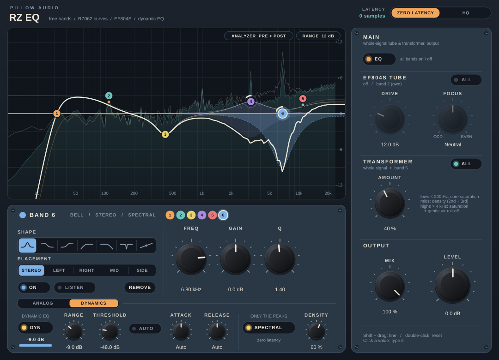
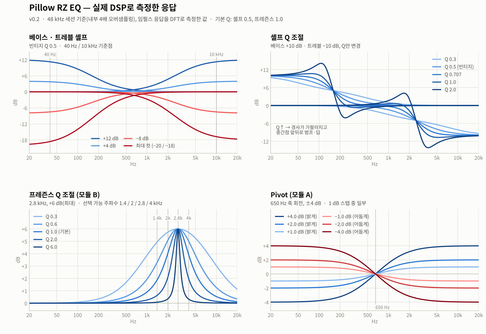
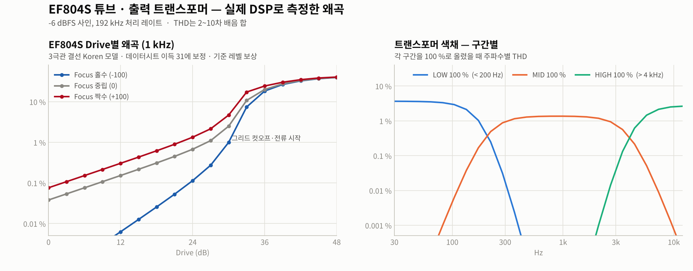

# Pillow RZ EQ (v0.3)

Klangfilm(Siemens) **RZ062a/b** 진공관 EQ 커브를 기반으로 **밴드별 Q 조절**을 더하고,
Plugin Alliance(NEOLD) RZ062를 참고해 **스테레오/M·S 모듈 조합 · Telefunken EF804S 튜브 · 구간별 출력 트랜스포머**를 넣은 EQ 플러그인입니다.
v0.3부터 기본 모드가 **ZERO LATENCY (레이턴시 0 샘플)** 입니다.
JUCE 8 / CMake 프로젝트이고 VST3 · AU · Standalone으로 빌드됩니다. (Cubase에서는 VST3 사용)







위 그래프는 전부 이 프로젝트의 DSP 코드를 실제로 돌려서 측정한 값이고, UI 그림도 실제 플러그인 화면을 렌더링한 것입니다.

---

## VST3 파일 만들기

### 방법 1 — GitHub에서 자동 빌드 (설치 불필요)
`main` 브랜치에 push 하면 GitHub의 Windows 서버가 MSVC로 빌드하고 DSP 테스트까지 돌립니다 (10분 안팎).
- 결과물: 저장소 → **Actions** → 최신 Build 실행 → 맨 아래 **Artifacts** → `PillowRZ-EQ-Windows-VST3`
- 같은 zip이 `builds` 브랜치에도 올라갑니다 (`PillowRZ-EQ-Windows-VST3.zip`, `PillowRZ-EQ-Windows-Standalone.zip`).
- 압축을 풀어 `Pillow RZ EQ.vst3` 폴더를 `C:\Program Files\Common Files\VST3` 에 넣고 Cubase에서 다시 스캔.

### 방법 2 — Windows PC에서 더블클릭
`build_windows.bat` 을 더블클릭하면 빌드 → VST3 폴더 설치까지 한 번에 합니다.
처음 한 번만 Visual Studio Build Tools, CMake, Git이 필요하고, 없으면 스크립트가 `winget` 설치 명령을 알려줍니다.
Mac이면 터미널에서 `bash build_mac.sh` (VST3 + AU).

---

## ZERO LATENCY / HQ

| | ZERO LATENCY (기본) | HQ |
|---|---|---|
| 레이턴시 | **0 샘플** (모든 샘플레이트) | 44.1/48k 6 샘플(0.13 ms), 88.2/96k 4 샘플, 176.4k 이상 0 |
| 처리 | 세션 레이트 그대로 | 44.1/48k 4배, 88.2/96k 2배 오버샘플링 |
| 튜브·트랜스포머 안티에일리어싱 | ADAA (아래 설명) | 오버샘플링 + ADAA |
| CPU | HQ의 약 1/4 | |
| 쓰임 | 녹음 모니터링, 트래킹, 평소 믹스 | 무거운 드라이브 + 고역이 많은 소스, 마스터링 |

- 재생 중에도 바꿀 수 있습니다 (약 10 ms 페이드). 레이턴시가 바뀌는 설정이라 **자동화는 막아 두었습니다.**
- 바뀐 레이턴시는 호스트에 바로 알려서 Cubase의 지연 보상이 따라옵니다.
- v0.2로 저장한 세션은 ZERO LATENCY로 열립니다. 예전과 똑같은 처리(오버샘플링)를 원하면 HQ를 누르세요.
- Drive를 아주 세게(36 dB 이상) 걸고 고역이 많은 소리를 넣으면, ZERO LATENCY의 순간 피크가 HQ보다 1~2 dB 높게 나올 수 있습니다 (평균 레벨·음색은 같음). 이런 설정으로 마스터링할 때는 HQ를 권합니다.

**ZERO LATENCY에서 오버샘플링 없이 품질을 지키는 방법**
- **ADAA (역도함수 안티에일리어싱)**: 튜브·트랜스포머 곡선을 "샘플 사이를 직선으로 이은 구간의 평균"으로 계산해서 접혀 들어오는 배음(에일리어싱)을 줄입니다. 레이턴시가 없습니다.
  예) EF804S Drive 36 dB, 6 kHz: −28 → −38 dBc · 트랜스포머 HIGH 100 %, 7 kHz: −50 → −69 dBc (48 kHz)
- **선형 성분 정렬**: 그냥 ADAA를 쓰면 왜곡 성분이 반 샘플 늦어져서, 세게 걸면 고역의 압축이 덜 빠지고 고역이 수~10 dB 뜹니다.
  ADAA 출력에서 압축(입력과 같은 위상 성분)을 떼어내 지연 없이 다시 거는 보정을 넣어서, 기본파 레벨·위상이 **오버샘플링한 것과 0.01 dB 이내**로 같습니다 (Drive 30~48 dB, 1~15 kHz, 큰 저음 위의 고역도 0.3 dB 이내).
- **매칭 EQ 설계**: 일반적인 쌍선형 변환은 44.1/48k에서 고역 곡선이 찌그러집니다 (넓은 Presence는 20 kHz 근처 1.9 dB).
  극점은 아날로그 그대로 옮기고 크기 응답을 DC·기준 주파수·나이퀴스트에서 맞추는 설계(Vicanek 2016)로 바꿔서, 20 Hz~20 kHz 전체에서 아날로그 곡선과 **0.3 dB 이내** (무작위 설정 60개 기준 최대 0.28 dB, HQ는 0.03 dB).

---

## 컨트롤

**상단**

| 컨트롤 | 설명 |
|---|---|
| ZERO LATENCY · HQ | 처리 모드 (위 표) |
| STEREO L/R · MID/SIDE | 모듈 1 = 왼쪽(또는 Mid), 모듈 2 = 오른쪽(또는 Side). 전환할 때 5 ms 페이드로 클릭 없음 |
| LINK | 켜면 모듈 2가 모듈 1 설정을 그대로 따름 (기본값, 일반 스테레오 EQ). 끄면 따로 조절 |
| VINTAGE STEPS | 게인을 원본처럼 계단식으로 (셸프 2 dB, Pivot·Presence 1 dB). Q는 항상 연속 |

**모듈 (×2, 원본 RZ062 한 대씩)**

| 컨트롤 | 범위 | 비고 |
|---|---|---|
| A PIVOT / B PRESENCE | 모듈 종류 | NEOLD처럼 A+B, B+A 등 조합 가능 |
| TREBLE + Q | −18 ~ +12 dB, Q 0.3 ~ 2.0 (기본 0.5) | 10 kHz 기준 하이 셸프 |
| PIVOT (A) | ±4 dB | 650 Hz 축 틸트, 오른쪽 = 밝게 |
| PRESENCE (B) + FREQ + Q | 0 ~ +6 dB, 1.4 / 2 / 2.8 / 4 kHz, Q 0.3 ~ 6.0 (기본 1.0) | NEOLD 기준 1 dB × 6 |
| BASS + Q | −20 ~ +12 dB, Q 0.3 ~ 2.0 (기본 0.5) | 40 Hz 기준 로우 셸프 |
| DRIVE | 0 ~ 48 dB | EF804S 단에 들어가는 신호 크기 (상단 DRIVE 스위치가 켜져 있을 때) |
| LEVEL | ±18 dB | 모듈 출력 (M/S에서는 Mid/Side 레벨 = 스테레오 폭 조절) |

**TUBE (공통)**

| 컨트롤 | 설명 |
|---|---|
| EQ / DRIVE 스위치 | EQ와 튜브를 각각 켜고 끔 (NEOLD의 레버와 같은 역할) |
| FOCUS | 홀수 ↔ 짝수 배음. 0 = EF804S 단 그대로, −100 = 짝수 제거(대칭), +100 = 짝수 2배 |
| MIX | 원음 블렌드 (EQ + 튜브 + 트랜스포머를 병렬로) |

**OUTPUT TRANSFORMER (공통, 구간별)**

| 컨트롤 | 대역 | 하는 일 |
|---|---|---|
| LOW | 200 Hz 아래 | 코어 포화 — 큰 저음일수록 진해지는 3차 배음 위주 두께감 + 저음 압축 |
| MID | 200 Hz ~ 4 kHz | 은은한 밀도 — 약한 비대칭, 2차+3차 |
| HIGH | 4 kHz 위 | 고역 포화 + 12 kHz 위를 최대 −1.5 dB 부드럽게 (응답 곡선에 표시됨) |

배음은 구간별로 깔끔하게 나눠 만들고, 압축은 합이 원신호와 똑같은 구간 분할에 걸어서 크로스오버 근처에서도 항상 "눌리는" 방향으로만 동작합니다 (v0.2에서는 크로스오버 근처의 큰 신호가 오히려 최대 +0.7 dB 커지던 것을 v0.3에서 고침).

---

## EF804S 튜브 모델

RZ062 안의 EF804S 증폭단을 **Koren 3극관 모델**로 풀어서 얻은 실제 전달곡선을 씁니다 (tanh 같은 일반 곡선이 아님).

- **관 파라미터**: μ = 38 (EF804S 데이터시트의 3극관 결선 값). Ex·Kvb는 같은 계열 EF86의 Koren 모델을 따랐고, Kg1·Kp는 데이터시트의 "3극관 결선 RC 증폭 이득 31 (250 V, 100 kΩ)"이 정확히 나오도록 보정했습니다 (모델 결과 31.0, ra ≈ 23 kΩ, gm ≈ 1.7 mA/V @ 1 mA).
- **회로**: B+ 290 V, 플레이트 부하 220 kΩ, 바이패스 안 된 캐소드 저항(유휴 0.5 mA가 되도록 계산된 8.4 kΩ), 그리드 전류 소프트 클램프 — GroupDIY에 올라온 RZ062 실물 추정값 기반. 단 이득은 약 14배.
- **결과**: 약하게 걸면 2차 배음 위주, 그리드 전압이 커지면 컷오프와 그리드 전류 때문에 3차 배음이 주도 (그래프 왼쪽).
- **Drive 0 dB**는 풀스케일이 그리드 0.5 Vpk라 거의 깨끗하고, 30 dB 근처에서 본격적으로 걸립니다.
- **레벨 보상**: −12 dBFS 사인의 기본파 레벨이 Drive와 상관없이 같도록 자동 보정 (테스트상 0.00 dB 오차).
- 4,097점 asinh 워핑 테이블 + 3차 보간 (ADAA용 역도함수 테이블 포함), 회로를 직접 푼 값과 작은 신호에서 상대오차 1e-7 이하.

---

## 빌드 (직접 명령으로)

처음 configure 할 때 JUCE 8.0.17을 GitHub에서 자동으로 받아옵니다. 이미 JUCE가 있으면 이 폴더 안에 `JUCE/`로 넣어두면 그걸 씁니다.

```bat
cmake -B build -A x64
cmake --build build --config Release --target PillowRZ_VST3
```
결과물: `build\PillowRZ_artefacts\Release\VST3\Pillow RZ EQ.vst3`

DSP 테스트 (JUCE 없이도 됨): `g++ -std=c++17 -O2 -ISource tests/CoreTests.cpp -o CoreTests && ./CoreTests`

---

## 구조

```
Source/dsp/RZ062Core.h     DSP 전부 (JUCE 비의존): EQ(매칭 설계), EF804S, 트랜스포머, ADAA, 모듈·라우팅, 응답 곡선
Source/PluginProcessor.*   파라미터 33개, ZERO LATENCY / HQ 경로, 레이턴시 보고, 바이패스
Source/PluginEditor.*      UI: 모듈 패널 2개, 튜브/트랜스포머 패널, 응답 곡선
tests/CoreTests.cpp        161개 체크
build_windows.bat          Windows 원클릭 빌드 + VST3 설치
build_mac.sh               macOS 빌드 + VST3/AU 설치
.github/workflows/         GitHub Actions 자동 빌드 (Windows VST3 + Standalone)
```

신호 흐름 (모듈마다. ZERO LATENCY = 세션 레이트, HQ = 오버샘플된 레이트):

```
[L/R 또는 M/S] -> EQ -> EF804S -> 출력 트랜스포머 -> MIX(원음) -> LEVEL -> [디코드]
```

- **필터**: Cytomic(Andrew Simper) 선형 사다리꼴 SVF + 샘플 단위 계수 보간 → 큰 노브 변화에도 클릭 없음. 트레블·프레즌스·트랜스포머 셸프는 매칭 설계 계수를 SVF로 변환해서 사용.
- **트랜스포머·튜브**는 "왜곡 성분"만 만들어 원신호에 더하는 방식이라, 0이면 비트 단위로 완전히 투명합니다.
- 모듈 1의 파라미터 ID는 v0.1과 같아서 v0.1/v0.2로 저장한 세션도 열립니다.

---

## 원본 커브: 확인된 것과 추정한 것

**자료로 확인한 값** (Audified·NEOLD 매뉴얼, Plugin Alliance 제품 페이지, GroupDIY 실물 측정, 리뷰 기사)
- 베이스 40 Hz 기준 +12 / −20 dB, 트레블 10 kHz 기준 +12 / −18 dB, 원본 2 dB 스텝
- A 모듈 Pivot: 650 Hz 중심 ±4 dB / B 모듈 Presence: 1.4 / 2 / 2.8 / 4 kHz
- Presence 최대치: NEOLD는 1 dB × 6 = 6 dB, 실물 측정 자료는 0.8 dB × 6 = 4.8 dB → v0.2부터 NEOLD 기준
- EF804S: μ 38, 3극관 RC 증폭 이득 31 (데이터시트) / RZ062 안의 결선·전류는 GroupDIY 추정

**공개 자료가 없어 추정한 값** (전부 `Source/dsp/RZ062Core.h` 상수)
- 셸프 중간점 160 Hz / 2.5 kHz (650 Hz 축 대칭), 빈티지 셸프 Q 0.5, 프레즌스 기본 Q 1.0
- 트랜스포머 크로스오버 200 Hz / 4 kHz와 구간별 포화량 (100 %에서 −6 dBFS 기준 LOW 3.5 % · MID 1.4 % · HIGH 2.3 %)

---

## 바꾸고 싶을 때

| 하고 싶은 것 | 고칠 곳 (`RZ062Core.h`) |
|---|---|
| 셸프 위치/성격 | `kBassShelfHz`, `kTrebleShelfHz`, `kVintageShelfQ` |
| 프레즌스 최대치·스텝 | `kPresMaxDb`, `kMidStepDb` |
| 튜브가 걸리기 시작하는 지점 | `TubeStage::kGridVoltsPerFullScale` |
| EF804S 회로 (전압·부하·전류) | `Ef804sCurve::kBplus`, `kRl`, `kIdleA` |
| 트랜스포머 구간 경계·강도 | `TransformerStage::kXoverLowHz/HighHz`, `kLowDrive`, `kMidDrive`, `kHighDrive`, `kShelfMaxCutDb` |
| HQ 오버샘플링 배율 | `oversamplingOrderFor()` |
| ZERO LATENCY 보정이 따라가는 속도 | `AdaaAligned::kAvgSeconds`, `kSlowSeconds` |

## 검증 상태
- DSP 코어: GCC·Clang·MSVC(GitHub)에서 테스트 161개 통과 — 응답 곡선 vs 실제 처리(44.1k~192k), 두 모드의 아날로그 곡선 일치, 클릭(라우팅·링크 전환 포함), 블록 크기 독립성, EF804S 데이터시트 대조, 튜브 레벨 보상·Focus, 트랜스포머 구간 분리·압축 방향, M/S·링크·Mix, ADAA 에일리어싱 감소와 기본파 정렬, 극단적인 입력(표 끝·온셋·DC·NaN). AddressSanitizer·UBSan에서도 오류 없음.
- 플러그인 코드: JUCE 8.0.17에 대고 GCC·Clang 컴파일 (엄격한 경고 옵션에서 에러·경고 0), 실제 프로세서로 레이턴시 측정 (ZERO LATENCY: 보고 0 / 임펄스 0, HQ 48k: 보고 6 / 임펄스 6, 바이패스도 같은 위치), 재생 중 모드 전환(블록 128~2048 모두 약 10 ms), NaN 입력 뒤 자동 복구, 예전 세션 복원, 실제 에디터를 오프스크린 렌더링해서 레이아웃 확인.

배포할 계획이면: 제품명과 UI에는 "Klangfilm" 상표를 넣지 않고 "RZ062-style"이라고만 표기해 두었습니다.
